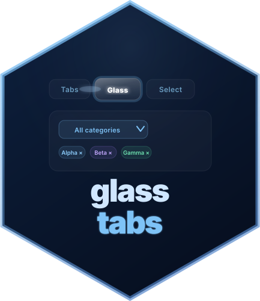
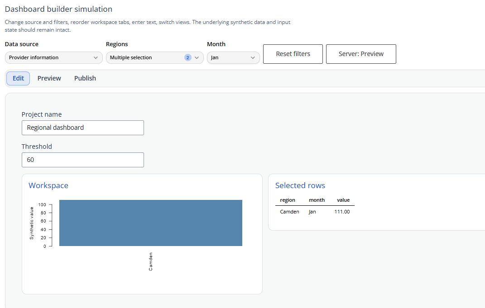
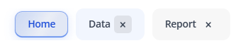
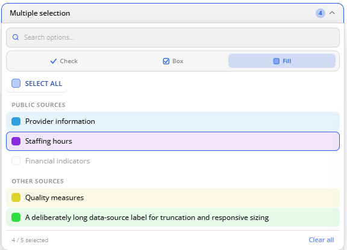
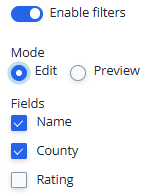
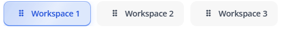
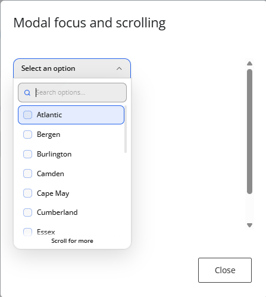
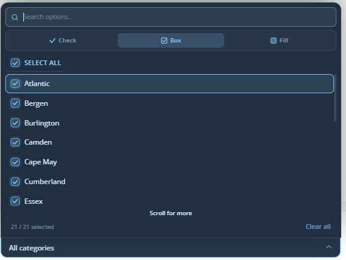
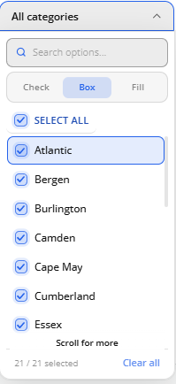

# glasstabs 

**Modern navigation and inputs for R Shiny.**

<!-- badges: start -->

[](https://CRAN.R-project.org/package=glasstabs) [](https://github.com/PrigasG/glasstabs/actions/workflows/R-CMD-check.yaml) [](https://app.codecov.io/gh/PrigasG/glasstabs) [](https://prigas89-glasstabs.share.connect.posit.cloud)

<!-- badges: end -->

glasstabs provides animated tab navigation, searchable filters, and glass-styled form controls for Shiny. Build responsive dashboards, interactive workspaces, and data-driven applications without writing custom JavaScript or CSS for the controls.

Use the components individually or together in existing `fluidPage()`, `bslib`, and `bs4Dash` applications. Choose light or dark surfaces, automatic theming, compact layouts, or a custom appearance.

**Version note:** This README describes 0.4.2. Persistent ordering, closable tabs, touch reorder handles, and the new form inputs require 0.4.2. If your installed package reports an earlier version, install 0.4.2 from GitHub. See [What's new in 0.4.2](https://prigasg.github.io/glasstabs/articles/whats-new-042.html).



[Documentation](https://prigasg.github.io/glasstabs/) · [Live demo](https://prigas89-glasstabs.share.connect.posit.cloud) · [Component gallery](https://prigasg.github.io/glasstabs/articles/component-gallery.html) · [Changelog](https://prigasg.github.io/glasstabs/news/index.html)

## Components

| [Navigation](https://prigasg.github.io/glasstabs/articles/tabs.html) | [Selects](https://prigasg.github.io/glasstabs/articles/multiselect.html) | [Form inputs](https://prigasg.github.io/glasstabs/articles/component-gallery.html) |
| :--- | :--- | :--- |
|  |  |  |
| Responsive, configurable tab navigation. | Searchable single and multi-select filters. | Native-bound switches, radio groups, and checkboxes. |

## Installation

Install the CRAN release:

```r
install.packages("glasstabs")
```

To install 0.4.2 from GitHub:

```r
# Requires the pak package
pak::pak("PrigasG/glasstabs@main")
packageVersion("glasstabs")
```

The GitHub installation replaces the installed package in the target R library. For production deployments, use a tested release or pin the GitHub commit used for verification.

## Quick start

Call `useGlassTabs()` once at the UI root. The following complete app combines two tabs, a multi-select filter, selected-value tags, and a reactive active-tab readout. It uses the established API and does not require the new 0.4.2 workspace features.

```r
library(shiny)
library(glasstabs)

choices <- c(Apple = "apple", Banana = "banana", Cherry = "cherry")

ui <- fluidPage(
  useGlassTabs(),
  glassTabsUI(
    "main",
    glassTabPanel(
      "overview", "Overview", selected = TRUE,
      h3("Fruit summary"),
      glassFilterTags("fruit")
    ),
    glassTabPanel(
      "details", "Details",
      h3("Selection details"),
      verbatimTextOutput("selection")
    ),
    extra_ui = glassMultiSelect(
      "fruit",
      choices,
      width = "240px",
      show_style_switcher = FALSE
    )
  ),
  verbatimTextOutput("active_tab")
)

server <- function(input, output, session) {
  active_tab <- glassTabsServer("main")
  output$active_tab <- renderPrint(active_tab())
  output$selection <- renderPrint(input$fruit)
}

if (interactive()) shinyApp(ui, server)
```

`glassMultiSelect()` selects every enabled choice by default. To start with no selections, set `selected = character(0)`.

See the [Getting started guide](https://prigasg.github.io/glasstabs/articles/getting-started.html) for more examples.

## Watch the demos

Watch the compact MP4 recordings:

- [Dashboard workflow: filters, tabs, and preserved input state](https://prigasg.github.io/glasstabs/media/dashboard-workflow.mp4)
- [Configurable navigation: layouts, themes, and tab operations](https://prigasg.github.io/glasstabs/media/configurable-navigation.mp4)

## Feature highlights

### Navigation and workspaces

Choose floating, attached, or segmented navigation, with glass, solid, or underline indicators. Use horizontal or vertical layouts, compact spacing, numeric badges, and configurable overflow. Tab helpers support server-driven selection, showing and hiding, enabling and disabling, and runtime insertion and removal.



With 0.4.2, opt into desktop and keyboard reordering, touch handles, and browser-persisted order. A closable tab sends a request to the server, giving the application control over whether the pane is removed.

```r
# UI (0.4.2)
glassTabsUI(
  "workspace",
  glassTabPanel("home", "Home", p("Pinned")),
  glassTabPanel("report", "Report", textInput("notes", "Notes"),
                closable = TRUE),
  style = "segmented",
  indicator = "solid",
  transition = "none",
  theme = "auto",
  glass_strength = 0.25,
  reorderable = TRUE,
  touch_reorder = TRUE,
  persist_order = "session"
)

# Inside server: approve closure only when appropriate for the application.
observeEvent(input[["workspace-close_request"]], {
  value <- input[["workspace-close_request"]]
  if (identical(value, "report")) {
    removeGlassTab(session, "workspace", value)
  }
})
```

Read the active tab using `input[["workspace-active_tab"]]` and the order using `input[["workspace-tab_order"]]`. Browser persistence stores tab identifiers, not pane contents or account-specific state. Use `initial_order` with application-managed storage for authenticated, cross-device preferences. Closure does not persist tab deletion across fresh server sessions.

[Tabs and workspace guide](https://prigasg.github.io/glasstabs/articles/tabs.html) · [Indicator styles](https://prigasg.github.io/glasstabs/articles/indicators.html)

### Searchable filters

Both select widgets support search, disabled and grouped choices, programmatic updates, and configurable dropdown presentation.

```r
glassSelect(
  "region",
  c(North = "north", South = "south", East = "east", West = "west"),
  label = "Region",
  clearable = TRUE,
  width = "240px"
)

glassMultiSelect(
  "status",
  c(Open = "open", Review = "review", Closed = "closed"),
  label = "Status",
  selected = c("open", "review"),
  width = "100%"
)
```

The single-select returns one character value or `NULL` when cleared. An empty-string choice is a distinct selection. The multi-select returns the selected choice values; use `glassFilterTags("status")` to display selection tags.

For large choice sets, use `server = TRUE` with `glassSelectServer()` or `glassMultiSelectServer()`. The constructor's `server_limit` bounds the initial choice slice, while the helper's `limit` bounds search results. Explicitly selected values may be rendered in addition to the initial slice. Results are bounded, not paginated.



[Single-select guide](https://prigasg.github.io/glasstabs/articles/glassSelect.html) · [Multi-select guide](https://prigasg.github.io/glasstabs/articles/multiselect.html) · [Linked filters](https://prigasg.github.io/glasstabs/articles/linked-filters.html)

### Native-bound form inputs

Available in 0.4.2, the form components use standard Shiny input bindings. They can be read and updated using familiar Shiny server code.

```r
glassSwitch("enabled", "Enable filtering", value = TRUE)

glassRadioGroup(
  "mode", "Mode",
  choices = c(Edit = "edit", Preview = "preview"),
  inline = TRUE
)

glassCheckboxGroup(
  "fields", "Fields",
  choices = c(Name = "name", County = "county", Rating = "rating"),
  selected = c("name", "county"),
  inline = TRUE
)
```

| Input | Shiny update function |
| :--- | :--- |
| `glassSwitch()` | `updateCheckboxInput()` |
| `glassRadioGroup()` | `updateRadioButtons()` |
| `glassCheckboxGroup()` | `updateCheckboxGroupInput()` |

[Form input reference](https://prigasg.github.io/glasstabs/reference/glassSwitch.html)

### Match the surrounding app

Use `theme = "auto"` to follow Bootstrap color modes, or choose a fixed light or dark theme. Set `shape = "square"` on tabs and selects to complement square native controls. In 0.4.2, `glass_strength` adjusts decorative glass intensity, and `size` adjusts input density.

```r
# 0.4.2 appearance options
glassSelect(
  "dataset", c(Providers = "providers", Population = "population"),
  label = "Dataset",
  theme = "auto",
  shape = "square",
  width = "240px",
  size = "sm",
  glass_strength = 0.25
)
```

For more control, use `glass_tab_theme()` and `glass_select_theme()`. A custom `dark_selector` can connect the widgets to an application's own dark-mode signal.



### Responsive layouts and accessibility

Tabs support keyboard navigation, responsive overflow, and reduced-motion preferences. Horizontal tab strips can scroll, wrap across rows, or collapse into a compact menu. Vertical navigation uses a rail. Optional pane swipe gestures and 0.4.2 reorder handles support touch interaction. Selects adapt their panels to the available space and support keyboard navigation and long labels.



[Responsive design and accessibility](https://prigasg.github.io/glasstabs/articles/responsive-accessibility.html)

## Dropdown too narrow? Set `width` {#dropdown-too-narrow-set-width}

Both select widgets retain a compact 160px default. Use explicit CSS lengths or a percentage to match the surrounding layout.

| `width` | Use |
| :--- | :--- |
| `NULL` (default) | Compact 160px control. |
| `"130px"` | Narrow toolbar field. |
| `"260px"` | More room for longer labels. |
| `"100%"` | Fill the parent card, column, or sidebar. |

A percentage fills the parent container, not the screen. Explicit widths are capped by the available container space. In 0.4.2, `dropdown_max_height` can limit the scrollable option area; short lists use only the space they need.

## Shiny integration

Read values with ordinary Shiny inputs, use reactive helpers where useful, and update components from the server.

| Input | Meaning |
| :--- | :--- |
| `input[["main-active_tab"]]` | Active tab value, or `NULL` when no tab is active (0.4.2). |
| `input[["main-tab_order"]]` | Ordered tab values when reordering is enabled (0.4.2). |
| `input[["main-close_request"]]` | Server-controlled close request (0.4.2). |
| `input$region` | Single selected value, or `NULL`. |
| `input$status` | Multi-select choice values. |
| `input$status_open` | Whether the select dropdown is open. |
| `input$enabled`, `input$mode`, `input$fields` | Standard Shiny switch, radio, and checkbox values (0.4.2). |

Use `updateGlassTabsUI()`, `updateGlassTabBadge()`, `updateGlassSelect()`, and `updateGlassMultiSelect()` to coordinate navigation and filters. For linked filters, `notify = "changed"` synchronizes each updated widget whose effective value changes. See the [linked filters guide](https://prigasg.github.io/glasstabs/articles/linked-filters.html) for coordinated updates.

`glassPage()` is an experimental fillable page wrapper for `bslib`. It loads the glasstabs dependency automatically, so do not add a second `useGlassTabs()` call when using it.

[Shiny modules](https://prigasg.github.io/glasstabs/articles/modules.html) · [Function reference](https://prigasg.github.io/glasstabs/reference/)

## Try the examples

Example apps ship with the package. List the examples available in your installed version or launch a specific app from an interactive R session:

```r
library(glasstabs)
runGlassExample()
runGlassExample("dashboard")
```

| Explore | Built-in examples |
| :--- | :--- |
| Start with the fundamentals | `basic`, `dashboard` |
| Modern navigation and form inputs (0.4.2) | `modernization`, `final-features` |
| Themes and indicator styles | `indicators`, `light-mode`, `theme-switcher`, `square-corners` |
| Integrate into existing apps | `bslib`, `bs4dash`, `native-comparison` |
| Search large datasets | `server-select` |
| Publish a workflow | `connect-workflow` |
| Explore behavior and performance | `smoke-test`, `stress-test` |

The stress test is a diagnostic example, not an application starter.

[Full example gallery](https://prigasg.github.io/glasstabs/articles/examples-gallery.html) · [Live Posit Connect demo](https://prigas89-glasstabs.share.connect.posit.cloud)

## Documentation and support

Visit the [glasstabs documentation website](https://prigasg.github.io/glasstabs/) for complete function signatures, examples, and implementation guidance.

| Guide | Topics |
| :--- | :--- |
| [Getting started](https://prigasg.github.io/glasstabs/articles/getting-started.html) | Setup and first application |
| [Component gallery](https://prigasg.github.io/glasstabs/articles/component-gallery.html) | Available controls and sample code |
| [Cheatsheet](https://prigasg.github.io/glasstabs/articles/cheatsheet.html) | Quick reference |
| [Tabs](https://prigasg.github.io/glasstabs/articles/tabs.html) and [indicators](https://prigasg.github.io/glasstabs/articles/indicators.html) | Layouts, transitions, and workspace management |
| [Single-select](https://prigasg.github.io/glasstabs/articles/glassSelect.html) and [multi-select](https://prigasg.github.io/glasstabs/articles/multiselect.html) | Selection behavior, search, and updates |
| [Modules](https://prigasg.github.io/glasstabs/articles/modules.html) and [linked filters](https://prigasg.github.io/glasstabs/articles/linked-filters.html) | Reusable and reactive application patterns |
| [Migration](https://prigasg.github.io/glasstabs/articles/migrating.html) and [troubleshooting](https://prigasg.github.io/glasstabs/articles/troubleshooting.html) | Moving from native inputs and resolving common problems |
| [Posit Connect](https://prigasg.github.io/glasstabs/articles/posit-connect.html) | Deployment and verification |
| [What's new in 0.4.2](https://prigasg.github.io/glasstabs/articles/whats-new-042.html) | Release highlights |

For the complete API, browse the [function reference](https://prigasg.github.io/glasstabs/reference/).

Release notes are maintained in [`NEWS.md`](NEWS.md), on the [changelog](https://prigasg.github.io/glasstabs/news/index.html), and through `glasstabs_news()` in R.

Report bugs or request improvements through [GitHub Issues](https://github.com/PrigasG/glasstabs/issues). When reporting an issue, include the package version, host layout, browser, and a minimal reproducible Shiny example if possible.

## License

MIT. See [LICENSE](LICENSE).
